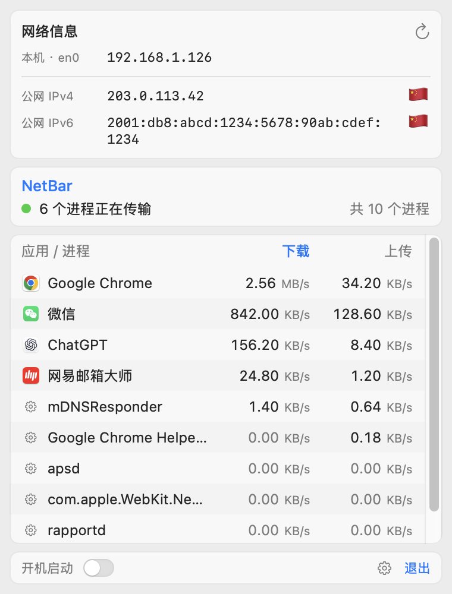
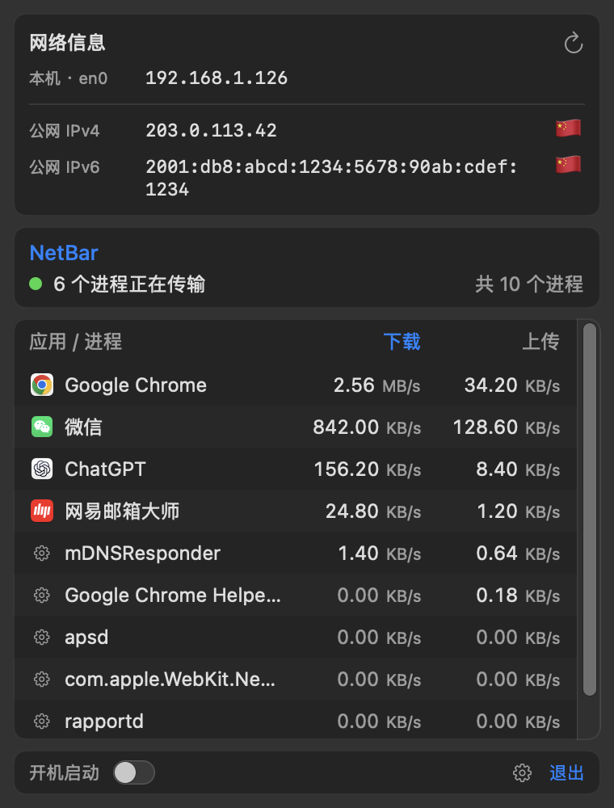
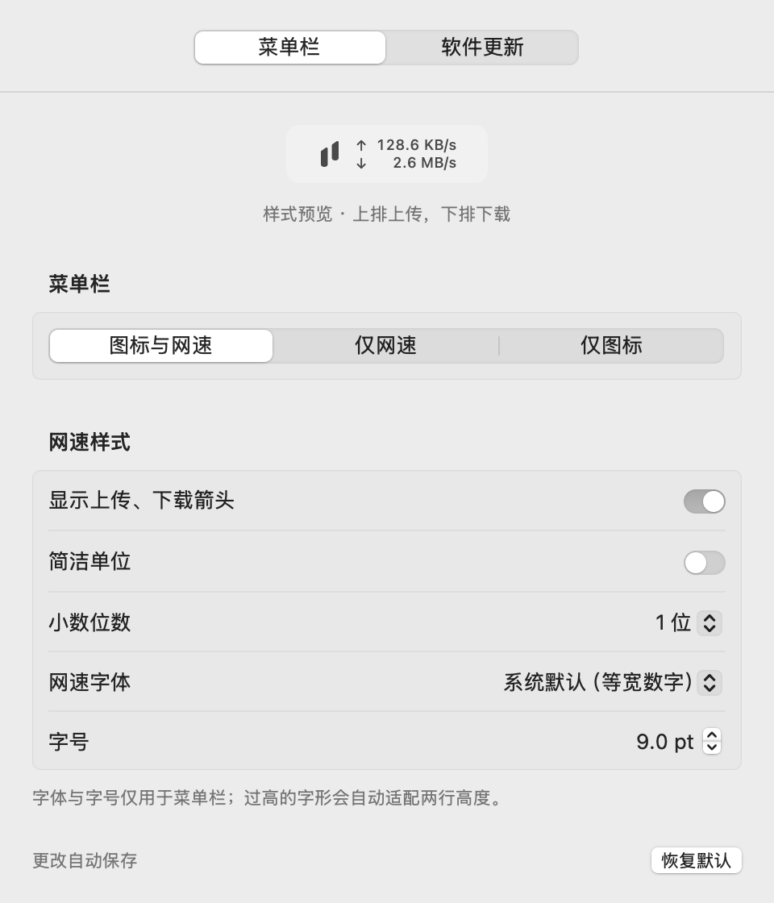
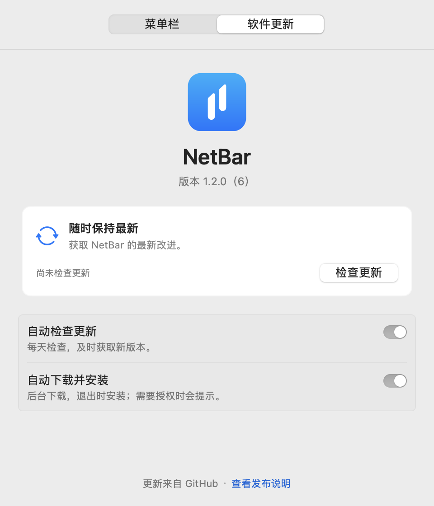

# NetBar

在 Mac 菜单栏随时查看网速，点开就能了解哪些进程正在传输数据，以及当前使用的网络地址。

NetBar 是一款轻量的 macOS 菜单栏工具：平时显示上传和下载速率，需要时展开查看明细。支持浅色与深色外观，无需管理员权限，也不安装额外后台服务。

## 能做什么

- **随时看网速**：菜单栏上排显示上传、下排显示下载，约每秒更新，单位自动调整。
- **查看流量明细**：按上传或下载速率排序，找到正在传输数据的应用与进程。
- **快速复制网络地址**：查看本机地址、公网 IPv4／IPv6 和可用的出口地区，点击地址即可复制。
- **按喜好调整菜单栏**：选择图标与网速、仅网速或仅图标，自定义箭头、单位、小数位、字体和字号，设置即时生效并自动保存。
- **按需查看，减少后台工作**：关闭面板后停止进程采样和地址查询；启用菜单栏网速时，速率仍会持续更新。

## 界面预览

展开面板即可查看网络地址与进程流量，浅色和深色外观都能保持清晰。

| 浅色外观 | 深色外观 |
| --- | --- |
|  |  |

本页界面图片均由应用视图渲染，使用示例流量和地址，不代表实时网络状态。

## 安装

需要 **Apple Silicon（M 系列芯片）Mac，macOS 13 或更高版本**。

从 [GitHub Releases](https://github.com/hygao1024/net-bar/releases) 下载 `arm64.dmg` 安装包，打开后将 `NetBar.app` 拖到“应用程序”文件夹，再打开应用。启动后，入口会出现在菜单栏。

当前仓库生成的应用使用本机临时签名，尚未经过 Apple 公证；发布安装包仅支持 arm64。

### 从源码构建

需要 Swift 6.0 或更高版本的 Xcode Command Line Tools（命令行开发工具），Swift 包管理器会自动获取锁定版本的 Sparkle 更新框架，首次构建需要联网。在仓库目录执行：

```bash
bash scripts/build-app.sh
open dist/NetBar.app
```

生成的应用位于 `dist/NetBar.app`，也可以拖到“应用程序”文件夹使用。开发、打包与验证方法见 [AGENTS.md](AGENTS.md#开发与构建)。

### 从 NetSpeed 升级

退出旧应用，安装 `NetBar.app`，并移除旧应用副本。已有菜单栏偏好设置会继续保留。如果之前开启过开机启动，请在新应用中检查状态；应用名称和路径变化后，可能需要关闭并重新开启该选项。

## 日常使用

**查看明细**：点击菜单栏入口展开面板，上方是网络地址，下方是应用与进程流量。进程速率约一秒后显示，默认按下载速率从高到低排列；点击“上传”或“下载”切换排序，再次点击切换升降序。悬停在名称上可查看完整名称与 PID（进程编号）。

**调整显示**：点击面板底部齿轮打开设置，在“菜单栏”页调整样式。可选择 0／1／2 位小数、简洁单位 K／M／G，以及本机字体和 7–12 pt 字号。窗口提供即时预览；“恢复默认”可重置全部菜单栏样式。仅图标模式暂停网速更新，切回后约一秒恢复。



**刷新地址**：点击地址复制，点击刷新按钮重新查询。切换代理或 VPN（虚拟专用网络）后，如果地址尚未更新，可以手动刷新。

**开机启动**：先将应用放到“应用程序”文件夹，再开启面板底部的“开机启动”。它会在当前用户登录 Mac 后启动，首次运行默认关闭。若显示“待批准”，点击后前往系统设置允许。

**关闭与退出**：点击面板外、再次点击菜单栏入口或按 Esc 关闭面板；底部“退出”按钮或 ⌘Q 退出应用。设置会在下次启动时保留。

## 软件更新

设置中的“软件更新”页显示当前版本、上次检查时间和更新状态，点击“检查更新”可立即查看新版本。自动检查与自动下载默认开启，也可以分别关闭；正常情况下每天检查一次，下载在后台进行，关闭设置不会中止下载。

新版本验证通过后，在应用退出时自动安装；也可以通过更新窗口立即安装并重新打开。需要安装权限时会显示系统提示。检查或下载失败可以重试，也可从发布页手动下载；验证失败的更新不会替换当前应用。



请先将应用放在“应用程序”文件夹，再使用自动更新。应用仍使用临时签名，首次安装可能需要按 macOS 的安全提示允许打开。不含更新功能的旧版本需先手动安装一次支持更新的版本。

## 如何理解这些数字

NetBar 显示的是**当前实际流量速率**，包含局域网流量和 VPN 的物理出口流量，不代表宽带最大速度，也不提供历史趋势或累计流量报表。

菜单栏统计在线 Wi-Fi／以太网接口的合计流量；面板按进程列出当前可见的联网活动，也保留暂时空闲的进程。浏览器辅助进程等会单独显示，列表不是所有已安装应用的清单。代理、VPN 和系统服务会影响流量归属，因此不能把列表简单相加来核对菜单栏数字。

速率使用字节单位：KB/s（千字节每秒）、MB/s（兆字节每秒），菜单栏还支持 GB/s（吉字节每秒）；简洁样式的 K／M／G 省略了 B/s。应用列表固定保留两位小数，不受菜单栏样式影响。

刚启动、休眠恢复或读取失败时，菜单栏可能显示“—”；悬停可查看原因，读取失败会自动重试。进程采样失败时，面板会显示错误并提供重试。公网地址的“暂不可用”表示本次查询失败，不代表设备不支持该地址类型。

## 数据与隐私

公网地址查询只在面板展开时进行。应用通过 HTTPS 分别访问 `ipv4.icanhazip.com` 和 `ipv6.icanhazip.com`，再将查到的地址发送给 `ipwho.is` 查询国家／地区。这些服务会看到请求的出口地址；地区查询失败时仍会显示已取得的地址。

代理或 VPN 可能影响查询结果，IPv4 与 IPv6 的出口也可能不同。应用不在磁盘保存网络地址，也不保存流量历史。

更新检查会访问 GitHub 及其附件分发服务，对方可看到出口地址和请求元数据（包括应用及系统版本），但不会收到进程流量或网络地址面板数据。更新不启用 Sparkle 的额外系统分析统计；下载的安装包会临时缓存于磁盘。关闭“自动检查更新”可停止后续定期检查，不会取消已经开始的更新；手动发起的下载可在更新窗口取消。

## 参与开发

开发环境、模块职责、运行机制和验证入口见 [AGENTS.md](AGENTS.md)。界面布局与交互取舍见[界面设计说明](docs/interface-design.md)。
